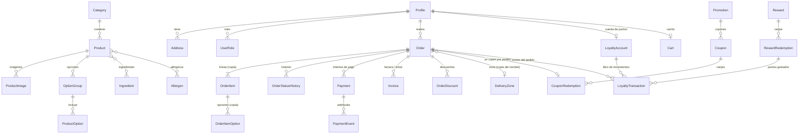

# Base de datos

PostgreSQL + Prisma 7. El esquema está en `backend/prisma/schema.prisma` y las migraciones en `backend/prisma/migrations/`. La base la usa **únicamente el backend**; ni la web ni Flutter acceden a ella directamente.

## Comandos (desde `backend/`)

| Comando               | Acción                                                                       |
| --------------------- | ---------------------------------------------------------------------------- |
| `npm run db:generate` | Genera el cliente de Prisma en `src/generated/` (se ejecuta en `npm ci`)     |
| `npm run db:migrate`  | Crea y aplica una migración en desarrollo (`prisma migrate dev`)             |
| `npm run db:deploy`   | Aplica las migraciones pendientes sin crear nada nuevo (producción y CI)     |
| `npm run db:seed`     | Siembra los datos de demostración (idempotente)                              |
| `npm run db:reset`    | Borra la base de desarrollo y reaplica las migraciones (**destructivo**)     |
| `npm run test:db`     | Pruebas de integridad contra `forno_test`; reconstruye el esquema desde cero |

`db:reset` destruye todos los datos. Prisma exige el consentimiento expreso del usuario cuando lo lanza un agente de IA.

## Modelo de datos

39 tablas agrupadas por dominio. Convenciones: UUID como identificador, `Decimal(10,2)` para dinero (con IVA incluido), `createdAt`/`updatedAt` y borrado lógico (`deletedAt`) en catálogo y cuentas.

| Dominio        | Tablas                                                                                                                                  |
| -------------- | --------------------------------------------------------------------------------------------------------------------------------------- |
| Usuarios       | `Profile`, `Address`, `UserRole`                                                                                                        |
| Catálogo       | `Category`, `Product`, `ProductImage`, `Ingredient`, `ProductIngredient`, `Allergen`, `ProductAllergen`, `OptionGroup`, `ProductOption` |
| Carrito        | `Cart`, `CartItem`, `CartItemOption`                                                                                                    |
| Tienda         | `StoreSettings`, `OpeningHours`, `SpecialOpeningHours`, `DeliveryZone`                                                                  |
| Promociones    | `Promotion`, `PromotionProduct`, `Coupon`, `CouponRedemption`, `OrderDiscount`                                                          |
| Pedidos        | `Order`, `OrderItem`, `OrderItemOption`, `OrderStatusHistory`                                                                           |
| Pagos y fiscal | `Payment`, `PaymentEvent`, `Invoice`, `InvoiceSequence`                                                                                 |
| Fidelización   | `LoyaltyAccount`, `LoyaltyTransaction`, `Reward`, `RewardRedemption`                                                                    |
| Transversales  | `IdempotencyRecord`, `AuditLog`, `NotificationLog`                                                                                      |

Respecto a la lista inicial de entidades se añadieron `OptionGroup` (agrupa las opciones de tamaño, masa y extras), `Ingredient`/`Allergen` (con tablas de enlace), `Cart*` (carrito sincronizado), `OrderDiscount`, `Invoice`/`InvoiceSequence` (facturas y tickets) y `NotificationLog` (cola de correos con reintentos).

## Reglas de integridad

Prisma no puede expresar todas las reglas, así que están en la migración `integrity_rules` (SQL escrito a mano). Cada una tiene una prueba en `backend/tests/db/`. La idea es que **la base de datos rechace los datos incoherentes aunque el código tenga un fallo**.

| Regla                                                                                                                   | Mecanismo                                            | Caso crítico |
| ----------------------------------------------------------------------------------------------------------------------- | ---------------------------------------------------- | ------------ |
| El saldo de puntos solo cambia al insertar un movimiento en el libro                                                    | Trigger `BEFORE INSERT` + guarda en `LoyaltyAccount` |              |
| Dos canjes simultáneos no pueden gastar los mismos puntos                                                               | Bloqueo de la fila de la cuenta (`FOR UPDATE`)       | 6            |
| No se puede canjear sin saldo suficiente; el saldo nunca es negativo                                                    | Trigger + `CHECK balance >= 0`                       | 5            |
| Los puntos de un pedido se conceden una sola vez y se revierten una sola vez                                            | Índices únicos parciales por tipo de movimiento      | 4, 8         |
| El libro de puntos, el historial de estados, los eventos de pago, las facturas y la auditoría no se editan ni se borran | Trigger `forbid_mutation()`                          |              |
| Ajustes administrativos con motivo y autor                                                                              | `CHECK`                                              |              |
| `total = subtotal − descuentos + envío`; importes no negativos                                                          | `CHECK`                                              |              |
| El subtotal del pedido coincide con la suma de sus líneas                                                               | Constraint trigger diferido (al confirmar)           | 3            |
| `lineTotal = precio × cantidad` y el IVA contenido es coherente con el precio con IVA incluido                          | `CHECK` (tolerancia de 1 céntimo)                    |              |
| Pedido a domicilio con dirección completa; recogida sin gastos de envío                                                 | `CHECK`                                              | 9            |
| Un pedido pendiente de pago no avanza sin un pago confirmado; un pago fallido no lo desbloquea                          | Trigger `BEFORE UPDATE OF status`                    | 7            |
| Un pedido se cobra una sola vez (online o efectivo)                                                                     | Índice único parcial                                 |              |
| Estados de efectivo (`CASH_*`) separados de los de pago online                                                          | `CHECK`                                              |              |
| Un webhook del proveedor no se procesa dos veces                                                                        | Único `(provider, providerEventId)`                  |              |
| Numeración de facturas correlativa y sin huecos                                                                         | `InvoiceSequence` con `UPSERT` atómico + único       |              |
| Franjas de apertura del mismo día sin solapes; festivos coherentes                                                      | `EXCLUDE` con `btree_gist`                           |              |
| Códigos postales válidos en las zonas de reparto                                                                        | `CHECK`                                              | 9            |
| Una dirección predeterminada y una imagen principal activas                                                             | Índices únicos parciales                             |              |
| Los pedidos conservan nombre, precio e IVA aunque cambie la carta                                                       | Copias (snapshots) + `ON DELETE RESTRICT`            |              |
| Ningún cliente con datos de Supabase puede leer o escribir tablas de negocio                                            | RLS activado en todas las tablas, sin políticas      |              |

Los casos críticos 1, 2 y 10 (aislamiento entre clientes, acceso al panel y pedido mínimo) y el 3 (manipulación de precios desde el navegador) se completan en el backend, en las fases 5–8: la base garantiza la coherencia, y el servicio decide qué usuario puede ver o hacer qué.

## Decisiones y puntos abiertos

- **Saldo nunca negativo (decidido por el propietario).** Cuando un pedido se cancela:
  1. **Puntos gastados en ese pedido:** se devuelven **completos**. Se registra un movimiento `REVERSAL` positivo identificado solo por `redemptionId` (sin `orderId`, para no chocar con la reversión de los puntos ganados) y el canje pasa a `CANCELLED`. Solo puede devolverse una vez.
  2. **Puntos ganados por ese pedido:** se revierten con un `REVERSAL` negativo identificado por `orderId`. Si el cliente ya gastó parte de ellos, el servicio de la Fase 7 revierte únicamente lo que queda (nunca deja el saldo por debajo de cero) y anota en `reason` cuántos puntos se revirtieron de cuántos.
- **Perfiles nunca se borran físicamente.** Los pedidos, el libro de puntos y la auditoría los referencian; el derecho de supresión (RGPD) se atiende anonimizando el perfil. Por eso esas claves foráneas son `RESTRICT`.
- **IVA.** Tipos vigentes en 2026 en `docs/decisions/0004-iva.md`: 10 % para comida preparada y agua, 21 % para alcohol y bebidas refrescantes con azúcares añadidos. Cada producto guarda su tipo (`Product.taxRate`) y cada pedido, una copia. Se calcula por línea (`total × tasa / (100 + tasa)`, a 2 decimales); el `CHECK` admite 1 céntimo de diferencia. El tratamiento del IVA de los gastos de envío y de los descuentos queda pendiente (ver ese documento).
- **`cancelledAt` también marca los rechazos** (`REJECTED`).
- **Transiciones de estado.** La tabla de transiciones válidas vive en el servicio (Fase 8); en la base solo se protege la salida de `PENDING_PAYMENT`, para no duplicar la regla en dos sitios.
- **Facturas inmutables.** Una factura emitida no se modifica; una rectificación será otra factura (abono). No se ha modelado todavía.
- **`Profile.id` = id de Supabase Auth.** En local no existe el esquema `auth`, por lo que no hay clave foránea hacia `auth.users`. En Supabase se valorará añadirla con una migración propia de ese entorno.
- **RLS por defecto en deny.** El backend se conecta con el rol propietario de las tablas (no sujeto a RLS). Toda tabla nueva debe activar RLS; `migrations.test.ts` falla si alguna no lo hace.

## Datos de demostración

`backend/prisma/seed-demo-data.ts` siembra la carta, los alérgenos, los ajustes de la tienda, los horarios, las zonas, las promociones, el cupón `BIENVENIDO10` y las recompensas. Son datos de ejemplo (los mismos que muestra la web) y están marcados como tales. No se crean usuarios: nacen en Supabase Auth. `db:seed` se niega a ejecutarse con `NODE_ENV=production`.

## Cómo añadir una migración

1. Edita `schema.prisma` y ejecuta `npm run db:migrate -- --name descripcion`.
2. Si la migración necesita SQL manual (un `CHECK`, un índice parcial, un trigger), usa `--create-only` y añádelo al archivo antes de aplicarla.
3. Activa RLS en cualquier tabla nueva (`ALTER TABLE ... ENABLE ROW LEVEL SECURITY`).
4. Ejecuta `npm run test:db`: comprueba que no hay deriva entre las migraciones y el esquema.
5. Nunca edites una migración ya aplicada: crea otra.

## Copias de seguridad y restauración

En producción (Supabase) se usarán las copias automáticas del proveedor y `pg_dump` periódico; el procedimiento detallado se documentará en la Fase 11 (`docs/deployment/`).
