# Diagrama de la base de datos

Generado automáticamente desde `backend/prisma/schema.prisma` (`npm run docs:schema` en `backend/`).
No lo edites a mano: una prueba comprueba que coincide con el esquema. Cada línea une una tabla con la
que referencia (clave foránea); `|o` indica que la referencia es opcional.

```mermaid
erDiagram
  Profile {
    string id PK
    string email UK
    string fullName
    string username
    string phone
    string taxId
    boolean marketingConsent
    datetime marketingConsentAt
    datetime createdAt
    datetime updatedAt
    datetime deletedAt
  }
  Address {
    string id PK
    string userId
    string label
    string recipientName
    string phone
    string line1
    string line2
    string postalCode
    string city
    string province
    string country
    string notes
    boolean isDefault
    datetime createdAt
    datetime updatedAt
    datetime deletedAt
  }
  UserRole {
    string id PK
    string userId
    enum role
    string grantedById
    datetime createdAt
  }
  Category {
    string id PK
    string slug UK
    string name
    string description
    int sortOrder
    boolean active
    datetime createdAt
    datetime updatedAt
    datetime deletedAt
  }
  Product {
    string id PK
    string categoryId
    string slug UK
    string name
    string description
    decimal basePrice
    decimal taxRate
    boolean vegetarian
    boolean available
    boolean popular
    int sortOrder
    datetime createdAt
    datetime updatedAt
    datetime deletedAt
  }
  ProductImage {
    string id PK
    string productId
    string url
    string alt
    int sortOrder
    boolean isPrimary
  }
  Ingredient {
    string id PK
    string name UK
  }
  ProductIngredient {
    string productId
    string ingredientId
    int position
  }
  Allergen {
    string id PK
    string code UK
    string name
  }
  ProductAllergen {
    string productId
    string allergenId
  }
  OptionGroup {
    string id PK
    string productId
    string name
    enum kind
    boolean required
    int minSelect
    int maxSelect
    int sortOrder
  }
  ProductOption {
    string id PK
    string groupId
    string name
    decimal priceDelta
    boolean isDefault
    boolean available
    int sortOrder
    datetime deletedAt
  }
  Cart {
    string id PK
    string userId UK
    datetime createdAt
    datetime updatedAt
  }
  CartItem {
    string id PK
    string cartId
    string productId
    int quantity
    string notes
  }
  CartItemOption {
    string cartItemId
    string optionId
  }
  StoreSettings {
    int id PK
    string name
    string legalName
    string taxId
    string addressLine
    string postalCode
    string city
    string phone
    string email
    string timezone
    string currency
    int prepTimeMinutes
    int deliveryTimeMinutes
    boolean pickupEnabled
    boolean deliveryEnabled
    boolean ordersPaused
    string pausedMessage
    enum enabledPaymentMethods_list
    int slotMinutes
    int maxAdvanceDays
    decimal loyaltyPointsPerEuro
    int loyaltyExpiryDays
    datetime updatedAt
  }
  OpeningHours {
    string id PK
    int dayOfWeek
    int openMinute
    int closeMinute
    boolean active
  }
  SpecialOpeningHours {
    string id PK
    datetime date
    boolean closed
    int openMinute
    int closeMinute
    string note
  }
  DeliveryZone {
    string id PK
    string name
    string postalCodes_list
    decimal deliveryFee
    decimal minimumOrder
    int estimatedMinutes
    boolean active
    datetime createdAt
    datetime updatedAt
    datetime deletedAt
  }
  Promotion {
    string id PK
    string name
    string description
    string badge
    enum kind
    enum discountType
    decimal discountValue
    decimal comboPrice
    decimal minSubtotal
    datetime startsAt
    datetime endsAt
    int maxRedemptions
    int perUserLimit
    boolean firstOrderOnly
    boolean automatic
    string conditions_list
    boolean active
    datetime createdAt
    datetime updatedAt
    datetime deletedAt
  }
  PromotionProduct {
    string promotionId
    string productId
    int quantity
  }
  Coupon {
    string id PK
    string code UK
    string promotionId
    string userId
    int maxRedemptions
    int perUserLimit
    datetime startsAt
    datetime endsAt
    boolean active
    datetime createdAt
    datetime updatedAt
  }
  CouponRedemption {
    string id PK
    string couponId
    string userId
    string orderId UK
    datetime createdAt
  }
  Order {
    string id PK
    int orderNumber UK
    string userId
    enum status
    enum type
    datetime scheduledFor
    datetime estimatedReadyAt
    string notes
    string customerName
    string customerEmail
    string customerPhone
    string deliveryName
    string deliveryLine1
    string deliveryLine2
    string deliveryPostalCode
    string deliveryCity
    string deliveryNotes
    string deliveryZoneId
    string deliveryZoneName
    decimal subtotal
    decimal discountTotal
    decimal deliveryFee
    decimal total
    decimal taxTotal
    string couponCode
    datetime placedAt
    datetime acceptedAt
    datetime readyAt
    datetime completedAt
    datetime cancelledAt
    string cancellationReason
    datetime createdAt
    datetime updatedAt
  }
  OrderItem {
    string id PK
    string orderId
    string productId
    string productName
    decimal unitPrice
    int quantity
    decimal taxRate
    decimal lineTotal
    decimal taxAmount
    string notes
  }
  OrderItemOption {
    string id PK
    string orderItemId
    string optionId
    string groupName
    string optionName
    decimal priceDelta
  }
  OrderStatusHistory {
    string id PK
    string orderId
    enum fromStatus
    enum toStatus
    string changedById
    string reason
    datetime createdAt
  }
  OrderDiscount {
    string id PK
    string orderId
    string promotionId
    string couponId
    string rewardRedemptionId
    string description
    decimal amount
  }
  Payment {
    string id PK
    string orderId
    enum method
    enum status
    decimal amount
    decimal refundedAmount
    string currency
    string provider
    string providerPaymentId
    string providerSessionId
    string failureReason
    datetime paidAt
    datetime createdAt
    datetime updatedAt
  }
  PaymentEvent {
    string id PK
    string paymentId
    string provider
    string providerEventId
    string type
    json payload
    datetime receivedAt
  }
  Invoice {
    string id PK
    string orderId
    enum type
    string series
    int year
    int number
    string invoiceNumber UK
    datetime issuedAt
    string customerName
    string customerTaxId
    string customerAddress
    decimal netTotal
    decimal taxTotal
    decimal total
    json taxBreakdown
    datetime createdAt
  }
  InvoiceSequence {
    string id PK
    string series
    int year
    int lastNumber
  }
  LoyaltyAccount {
    string id PK
    string userId UK
    int balance
    int lifetimeEarned
    datetime createdAt
    datetime updatedAt
  }
  LoyaltyTransaction {
    string id PK
    string accountId
    enum type
    int points
    int balanceAfter
    string orderId
    string redemptionId
    string reason
    string createdById
    string idempotencyKey UK
    datetime createdAt
  }
  Reward {
    string id PK
    string name
    string description
    int pointsCost
    string freeProductId
    decimal discountAmount
    int stock
    datetime validFrom
    datetime validTo
    boolean active
    int sortOrder
    datetime createdAt
    datetime updatedAt
    datetime deletedAt
  }
  RewardRedemption {
    string id PK
    string userId
    string rewardId
    string rewardName
    int pointsSpent
    enum status
    string orderId
    string idempotencyKey UK
    datetime expiresAt
    datetime usedAt
    datetime cancelledAt
    datetime createdAt
  }
  IdempotencyRecord {
    string id PK
    string userId
    string endpoint
    string key
    string requestHash
    int responseStatus
    json responseBody
    datetime createdAt
    datetime expiresAt
  }
  AuditLog {
    string id PK
    string actorId
    string action
    string entityType
    string entityId
    json before
    json after
    string reason
    string ip
    string userAgent
    datetime createdAt
  }
  NotificationLog {
    string id PK
    string orderId
    string userId
    string channel
    string template
    string recipient
    string subject
    string bodyText
    string bodyHtml
    enum status
    int attempts
    string lastError
    datetime nextAttemptAt
    datetime sentAt
    datetime createdAt
    datetime updatedAt
  }
  Profile ||--o{ Address : "userId"
  Profile ||--o{ UserRole : "userId"
  Profile |o--o{ UserRole : "grantedById"
  Category ||--o{ Product : "categoryId"
  Product ||--o{ ProductImage : "productId"
  Product ||--o{ ProductIngredient : "productId"
  Ingredient ||--o{ ProductIngredient : "ingredientId"
  Product ||--o{ ProductAllergen : "productId"
  Allergen ||--o{ ProductAllergen : "allergenId"
  Product ||--o{ OptionGroup : "productId"
  OptionGroup ||--o{ ProductOption : "groupId"
  Profile ||--o{ Cart : "userId"
  Cart ||--o{ CartItem : "cartId"
  Product ||--o{ CartItem : "productId"
  CartItem ||--o{ CartItemOption : "cartItemId"
  ProductOption ||--o{ CartItemOption : "optionId"
  Promotion ||--o{ PromotionProduct : "promotionId"
  Product ||--o{ PromotionProduct : "productId"
  Promotion ||--o{ Coupon : "promotionId"
  Profile |o--o{ Coupon : "userId"
  Coupon ||--o{ CouponRedemption : "couponId"
  Profile ||--o{ CouponRedemption : "userId"
  Order ||--o{ CouponRedemption : "orderId"
  Profile ||--o{ Order : "userId"
  DeliveryZone |o--o{ Order : "deliveryZoneId"
  Order ||--o{ OrderItem : "orderId"
  Product ||--o{ OrderItem : "productId"
  OrderItem ||--o{ OrderItemOption : "orderItemId"
  ProductOption |o--o{ OrderItemOption : "optionId"
  Order ||--o{ OrderStatusHistory : "orderId"
  Profile |o--o{ OrderStatusHistory : "changedById"
  Order ||--o{ OrderDiscount : "orderId"
  Promotion |o--o{ OrderDiscount : "promotionId"
  Coupon |o--o{ OrderDiscount : "couponId"
  RewardRedemption |o--o{ OrderDiscount : "rewardRedemptionId"
  Order ||--o{ Payment : "orderId"
  Payment |o--o{ PaymentEvent : "paymentId"
  Order ||--o{ Invoice : "orderId"
  Profile ||--o{ LoyaltyAccount : "userId"
  LoyaltyAccount ||--o{ LoyaltyTransaction : "accountId"
  Order |o--o{ LoyaltyTransaction : "orderId"
  RewardRedemption |o--o{ LoyaltyTransaction : "redemptionId"
  Profile |o--o{ LoyaltyTransaction : "createdById"
  Product |o--o{ Reward : "freeProductId"
  Profile ||--o{ RewardRedemption : "userId"
  Reward ||--o{ RewardRedemption : "rewardId"
  Order |o--o{ RewardRedemption : "orderId"
  Profile ||--o{ IdempotencyRecord : "userId"
  Profile |o--o{ AuditLog : "actorId"
  Order |o--o{ NotificationLog : "orderId"
  Profile |o--o{ NotificationLog : "userId"
```

