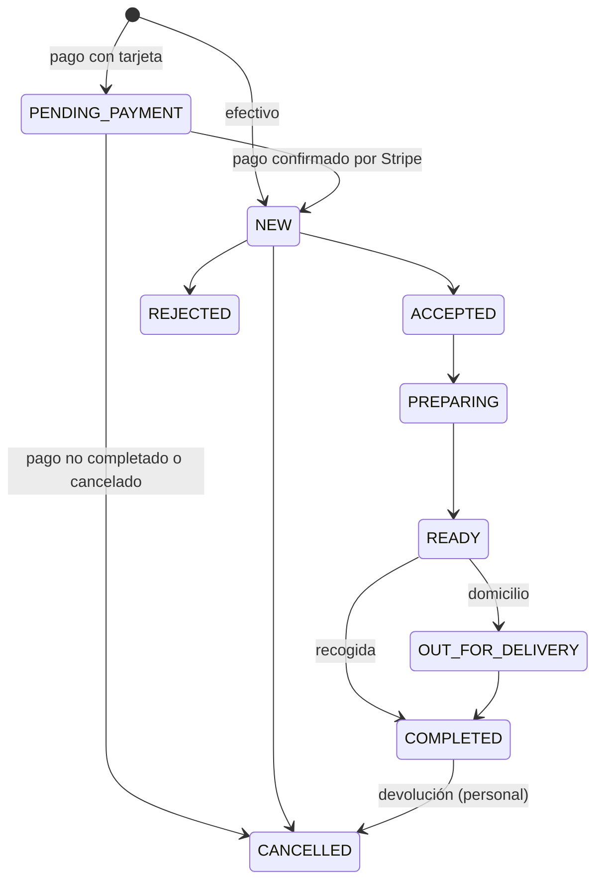

# Guía de integración para la app Flutter

Esta guía es para quien desarrolle la app móvil de FORNEA. **La app no reimplementa ninguna regla de
negocio**: consume la misma API REST que la web, con la misma identidad (Supabase Auth), los mismos
clientes, pedidos, puntos, promociones y recompensas.

> **Alcance.** Flutter no se desarrolla en este proyecto: esta guía y los contratos dejan el backend
> listo. Los fragmentos de Dart son **orientativos** (no se han compilado aquí); lo que sí está
> verificado automáticamente es la API: un cliente independiente recorre el viaje completo de la app
> usando solo el contrato publicado (ver [Cómo se ha comprobado](#cómo-se-ha-comprobado)).

## Qué entregamos

| Documento                                                      | Para qué                                                                                                                         |
| -------------------------------------------------------------- | -------------------------------------------------------------------------------------------------------------------------------- |
| [`../api/openapi.json`](../api/openapi.json)                   | **Contrato OpenAPI 3.1** de toda la API (más de 90 operaciones, con `operationId` estables). Fuente para generar el cliente Dart |
| [`ejemplos.md`](./ejemplos.md)                                 | Peticiones (`curl`) y respuestas **reales** de los flujos principales                                                            |
| [`errores.md`](./errores.md)                                   | Todos los códigos de error y qué debe hacer la app con cada uno                                                                  |
| [`reglas-de-negocio.md`](./reglas-de-negocio.md)               | Qué decide el servidor y qué NO debe hacer nunca la app                                                                          |
| [`../api/README.md`](../api/README.md)                         | Convenciones, límites y tabla de endpoints                                                                                       |
| [`../security/supabase-auth.md`](../security/supabase-auth.md) | Configuración de Supabase Auth (correo, Google)                                                                                  |

## 1. Generar el cliente

Con el contrato se genera un cliente tipado. Ejemplo con OpenAPI Generator (requiere Java o Docker):

```bash
openapi-generator-cli generate \
  -i docs/api/openapi.json \
  -g dart-dio \
  -o forno_api \
  --additional-properties=pubName=forno_api,nullSafe=true
```

Los métodos se llaman como el `operationId` (`getProducts`, `postOrders`, `getOrdersById`…). El
contrato se versiona con la API: `/api/v1` **no cambia de forma incompatible**; un cambio así saldría
como `/api/v2` con aviso previo (ver [Versionado](#versionado)). Se regenera con `npm run docs:openapi`
en `backend/` y una prueba impide que el archivo se quede desactualizado.

**Importes.** Llegan como **texto** con dos decimales (`"9.50"`, IVA incluido). En Dart no los
conviertas a `double`: usa el paquete `decimal` o enteros en céntimos. La app solo muestra importes;
nunca los calcula ni los envía.

## 2. Autenticación

La identidad es **Supabase Auth** (la misma que la web). La API acepta
`Authorization: Bearer <access token de Supabase>` y verifica la firma en cada petición con la clave
pública del proyecto. La app **nunca** envía su identidad, su rol ni sus permisos.

```dart
// pubspec.yaml: supabase_flutter
await Supabase.initialize(url: SUPABASE_URL, anonKey: SUPABASE_PUBLISHABLE_KEY); // clave PÚBLICA (sb_publishable_…)

// Correo y contraseña
await supabase.auth.signUp(email: email, password: password,
    data: {'full_name': name}, emailRedirectTo: 'io.fornea.app://login-callback/');
await supabase.auth.signInWithPassword(email: email, password: password);

// Google (abre el navegador y vuelve por un enlace profundo)
await supabase.auth.signInWithOAuth(OAuthProvider.google, redirectTo: 'io.fornea.app://login-callback/');

// Recuperar contraseña
await supabase.auth.resetPasswordForEmail(email, redirectTo: 'io.fornea.app://reset-callback/');
```

- **Claves.** En la app solo va la clave **publicable** de Supabase. La clave secreta (`sb_secret_…`), la
  de Stripe y la de IA **nunca** deben estar en la app.
- **Enlaces profundos.** Hay que dar de alta las URL de retorno (`io.fornea.app://…`) en Supabase →
  Authentication → URL Configuration, y registrar el esquema en Android (`intent-filter`) e iOS
  (`CFBundleURLTypes`).
- **Primera llamada.** `GET /me` crea el perfil del usuario en el servidor si aún no existe. Hasta que
  `profileComplete` sea `true` (nombre de usuario y teléfono, `PATCH /me`) no se puede pedir
  (`PROFILE_INCOMPLETE`).
- **Roles y permisos.** `GET /me` devuelve `roles` y `permissions` **solo para adaptar la interfaz**
  (mostrar u ocultar opciones). La autorización real la hace el servidor en cada petición.

### Renovación de la sesión

El access token dura poco (una hora por defecto). `supabase_flutter` guarda la sesión y la renueva sola
con el _refresh token_ mientras la app está abierta. Aun así, la app debe manejar el `401`:

```dart
// Interceptor de dio (orientativo)
onRequest: (options, handler) {
  final token = supabase.auth.currentSession?.accessToken;
  if (token != null) options.headers['Authorization'] = 'Bearer $token';
  handler.next(options);
},
onError: (error, handler) async {
  final code = error.response?.data?['error']?['code'];
  final alreadyRetried = error.requestOptions.extra['retried'] == true;
  if (error.response?.statusCode == 401 && code == 'TOKEN_EXPIRED' && !alreadyRetried) {
    await supabase.auth.refreshSession();                       // pide un token nuevo
    final retry = error.requestOptions..extra['retried'] = true;
    return handler.resolve(await dio.fetch(retry));            // reintenta UNA vez
  }
  if (error.response?.statusCode == 401) await supabase.auth.signOut(); // INVALID_TOKEN, etc.
  handler.next(error);
},
```

## 3. Convenciones que debe respetar la app

| Tema            | Regla                                                                                                                                                                                                               |
| --------------- | ------------------------------------------------------------------------------------------------------------------------------------------------------------------------------------------------------------------- |
| Respuestas      | `{ "data": … }`; listas paginadas `{ "data": […], "meta": { page, pageSize, total, totalPages } }`                                                                                                                  |
| Errores         | `{ "error": { code, message, details?, requestId } }`. La app decide por `code` (ver [`errores.md`](./errores.md)) y pone sus propios textos                                                                        |
| Fechas          | ISO 8601 en UTC. Los horarios del local son minutos desde las 00:00 en la zona `timezone` de `/store/settings`                                                                                                      |
| Identificadores | UUID (y `orderNumber`, entero visible para el cliente)                                                                                                                                                              |
| Paginación      | `?page=1&pageSize=10` (máximo 50)                                                                                                                                                                                   |
| Idempotencia    | Los `POST /orders` y `POST /loyalty/redemptions` **exigen** `Idempotency-Key` (UUID v4). Una clave por intención del usuario: se **reutiliza** al reintentar por fallo de red y se cambia si el usuario cambia algo |
| Límites         | 300 peticiones/min por IP, 240/min por usuario y 30 escrituras/min por usuario; al superarlos, `429` con `Retry-After`                                                                                              |
| Caché           | Los datos públicos (carta, promociones, local, zonas) llevan `Cache-Control: public, max-age=30`                                                                                                                    |
| Tamaño          | Cuerpos de hasta 100 kB                                                                                                                                                                                             |

## 4. Flujos principales

1. **Carta.** `getCategories`, `getProducts` (las imágenes vienen como ruta o URL: si empieza por `/`, es relativa a la web; si no, es absoluta). Productos agotados llegan con `available: false`.
2. **Carrito.** Se guarda en el dispositivo y, con sesión, se sincroniza con `putCart`/`getCart` (solo producto, opciones y cantidad; **nunca precios**).
3. **Presupuesto.** `postCheckoutQuote` (público; con sesión admite `couponCode` y `redemptionId`) devuelve líneas, descuentos, envío, IVA, total y puntos estimados. Es lo único que se muestra como precio.
4. **Modalidad y hora.** `getStoreSettings` (¿abierto?, pausa, métodos de pago), `getStoreSlots` (franjas válidas) y `getDeliveryZonesCheck` (¿se reparte en ese código postal?).
5. **Pedido.** `postOrders` con `Idempotency-Key`.
   - Efectivo → el pedido nace `NEW` con el cobro pendiente.
   - Tarjeta (`ONLINE`) → nace `PENDING_PAYMENT`; la app llama a `postOrdersByIdPaymentSession` y **abre la `url` devuelta** en el navegador del sistema (`url_launcher`, modo externo o pestaña personalizada). No hace falta `flutter_stripe`: el pago es la página de Stripe Checkout.
   - Al volver (enlace profundo o botón), la app **consulta** `getOrdersById` cada pocos segundos hasta que el estado deje de ser `PENDING_PAYMENT`. Volver del navegador **no prueba el pago**: solo lo confirma el servidor al recibir el aviso firmado de Stripe. Si no se paga, el pedido se cancela solo a los 30 minutos.
6. **Seguimiento.** `getOrdersMe` y `getOrdersById` (consulta cada ~20 s mientras esté en curso). El cliente puede cancelar con `postOrdersByIdCancel` mientras esté `NEW` o `PENDING_PAYMENT`.
7. **Documentos.** `getOrdersByIdDocuments` dice si el pedido está cobrado (`settled`). `getOrdersByIdDocumentsByType` (`ticket` o `invoice`) devuelve un **PDF**: hay que enviar el `Authorization` y guardar los bytes (no vale abrir la URL en un navegador sin sesión). La factura se pide antes con `postOrdersByIdInvoice` (datos fiscales).
8. **FORNEA CLUB.** `getLoyaltyAccount`, `getLoyaltyTransactions`, `getLoyaltyRewards`, `postLoyaltyRedemptions`, `getLoyaltyRedemptions` («Mis recompensas»). Una recompensa canjeada se aplica a un pedido con `redemptionId`.
9. **PizzAI.** Llamar a `getAssistantStatus` primero: con `available: false` se usa un modo de demostración **rotulado como tal**; con `true`, `postAssistantChat` (público; hasta 12 mensajes de 500 caracteres; el último, del usuario). Las respuestas son texto plano y deben mostrarse como «generadas por IA, pueden contener errores».
10. **Tiempo real.** La cocina usa SSE, pero es solo del personal. La app de clientes **consulta periódicamente**.

## 5. Estados del pedido



La app solo **muestra** el estado (textos propios por cada valor). No decide transiciones.

## 6. Qué no debe hacer la app

Resumen de [`reglas-de-negocio.md`](./reglas-de-negocio.md): no calcular precios, IVA, envío, descuentos ni
puntos; no decidir si un cupón vale; no validar horarios ni zonas (solo mostrar lo que diga la API); no
marcar nada como pagado; no guardar tokens fuera del almacén seguro de Supabase; no hablar nunca con
Stripe ni con el proveedor de IA directamente.

## Versionado

- La API está en `/api/v1`. Se pueden **añadir** campos, operaciones y valores de enumeraciones sin cambiar de versión: la app debe **ignorar los campos desconocidos** y tener un caso por defecto para estados o códigos nuevos.
- Un cambio **incompatible** (quitar o renombrar un campo, cambiar un tipo, endurecer una validación) saldrá como `/api/v2`, con `v1` mantenida durante un plazo anunciado. Cada cambio se apunta en [`../../CHANGELOG.md`](../../CHANGELOG.md).

## Cómo se ha comprobado

`backend/tests/consumer/mobile-journey.test.ts` es un **cliente independiente**: no importa código del
servidor; lee `docs/api/openapi.json`, llama por HTTP a la API real (con PostgreSQL) y valida cada
petición y cada respuesta —estados, cuerpos y errores— contra los esquemas del contrato. Recorre lo que
hará la app: carta pública, errores y renovación de sesión tras un `401`, perfil y direcciones, pedido en
efectivo con reintento idempotente, pago con tarjeta, ticket en PDF y factura, puntos y canjes, y el
asistente. Cubre **todas** las operaciones de la app (las de personal, cocina y el webhook de Stripe
quedan fuera). Si el servidor responde algo que el contrato no describe, la prueba falla.

Para repetirla: `docker compose up -d` y, en `backend/`, `npm run test:db -- tests/consumer`.
