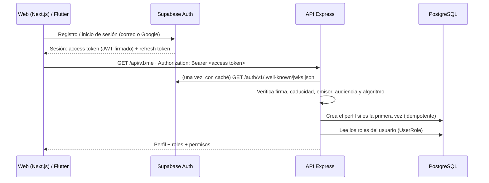

# Autenticación con Supabase Auth

Supabase Auth es el **proveedor de identidad compartido** entre la web y la futura app Flutter. Gestiona el registro, el inicio de sesión (correo y Google), la confirmación de correo y la recuperación de contraseña. **No guarda roles ni permisos de FORNO:** esos viven en nuestra base de datos y los decide el backend.

## Cómo funciona



1. El cliente obtiene el token de Supabase; el backend **nunca** recibe contraseñas.
2. En cada petición el backend **verifica el token él mismo** con la clave pública de Supabase (JWKS). No llama a Supabase por petición.
3. De un token válido solo se usan el id de usuario (`sub`), el correo y el nombre. **Los roles y permisos se leen siempre de la base de datos**: ni el token (`app_metadata`, `user_metadata`), ni cabeceras, ni parámetros ni el cuerpo pueden concederlos.
4. Un cambio de rol se aplica en la siguiente petición, sin esperar a que caduque el token.

## Reglas de seguridad aplicadas

| Regla                                                                                          | Dónde                                                 |
| ---------------------------------------------------------------------------------------------- | ----------------------------------------------------- |
| Solo se aceptan tokens firmados con claves asimétricas (`ES256`, `RS256`)                      | `backend/src/auth/token-verifier.ts`                  |
| Se rechazan tokens caducados, de otro emisor, de otra audiencia, `HS256`, `none` o manipulados | ídem, con pruebas                                     |
| Se rechazan usuarios anónimos y tokens `anon` / `service_role`                                 | ídem                                                  |
| Los roles y permisos salen de `UserRole`, nunca del cliente                                    | `backend/src/auth/authenticate.ts`                    |
| Permisos explícitos por rol (cliente, `STAFF`, `KITCHEN`, `ADMIN`)                             | `backend/src/auth/permissions.ts`                     |
| `PATCH /me` es estricto: rechaza correo, id, roles o cualquier campo desconocido               | `backend/src/modules/me/me.service.ts`                |
| Cuentas desactivadas (`deletedAt`) reciben 403                                                 | `backend/src/auth/profile-service.ts`                 |
| Nunca se queda la plataforma sin administradores                                               | `backend/src/auth/roles-service.ts`                   |
| Los cambios de rol quedan en la auditoría (`AuditLog`)                                         | ídem                                                  |
| Errores sin detalles internos y con `requestId`                                                | `backend/src/middleware/error-handler.ts`             |
| La recuperación de contraseña responde igual exista o no la cuenta                             | `frontend/src/features/auth/forgot-password-form.tsx` |
| El destino tras iniciar sesión (`next`) solo admite rutas internas (sin _open redirect_)       | `frontend/src/features/auth/routes.ts`                |
| Los mensajes de error de Supabase se traducen; nunca se muestra el texto original              | `frontend/src/features/auth/messages.ts`              |
| En el servidor se verifica con `getClaims()` (firma comprobada), no con `getSession()`         | `frontend/src/lib/supabase/update-session.ts`         |
| La clave secreta de Supabase no existe en el frontend                                          | `frontend/src/lib/supabase/config.ts`                 |

La protección de rutas del frontend (`src/proxy.ts`) **solo mejora la experiencia** (redirige a `/acceso`): la seguridad real está en el backend, que exige token y permiso en cada endpoint.

## Roles y permisos

| Rol         | Qué puede hacer                                                                               |
| ----------- | --------------------------------------------------------------------------------------------- |
| _(cliente)_ | Su perfil, sus pedidos y sus puntos. Es el estado de todo usuario registrado                  |
| `KITCHEN`   | Ver y avanzar pedidos en la pantalla de cocina. **Nada** de clientes, pagos ni administración |
| `STAFF`     | Todo lo de cocina, ver y gestionar todos los pedidos, ver clientes y pagos y el panel         |
| `ADMIN`     | Todo, incluido catálogo, promociones, puntos, ajustes, auditoría y roles                      |

### Crear el primer administrador

Nadie puede concederse un rol a sí mismo. El primer `ADMIN` se crea desde la terminal, **después de que esa persona haya iniciado sesión una vez** (así existe su perfil):

```bash
cd backend
npm run roles -- grant tu-correo@ejemplo.com ADMIN
npm run roles -- grant otra-persona@ejemplo.com KITCHEN
npm run roles -- revoke otra-persona@ejemplo.com KITCHEN
```

Cada cambio queda registrado en la auditoría. El último administrador no se puede retirar.

## Configurar Supabase (lo tienes que hacer tú)

No necesitas pagar: el plan gratuito basta para el desarrollo.

### 1. Crear el proyecto

1. Entra en <https://supabase.com>, crea una cuenta y un proyecto nuevo (guarda la contraseña de la base de datos).
2. En **Project Settings → API** copia:
   - **Project URL** (`https://<ref>.supabase.co`).
   - La clave **publishable** (`sb_publishable_…`). Es pública por diseño.
3. En **Project Settings → JWT Keys** comprueba que el proyecto usa claves de firma **asimétricas** (ES256, el valor por defecto en proyectos nuevos). El backend no admite `HS256`.

> **Nombres de las claves.** Supabase ha renombrado las claves: _publishable_ (`sb_publishable_…`) sustituye a `anon`, y _secret_ (`sb_secret_…`) a `service_role`. Las antiguas están en desuso y desaparecerán a finales de 2026. **No pegues nunca la clave secreta ni `service_role` en el frontend ni en Git.** Para esta fase el backend no necesita ninguna clave secreta.

### 2. URLs de redirección

En **Authentication → URL Configuration**:

- **Site URL:** `http://localhost:3000` (en producción, el dominio real).
- **Redirect URLs:** añade `http://localhost:3000/auth/callback` y `http://localhost:3000/auth/confirm` (y las del dominio real cuando exista).

### 3. Correo y contraseña

En **Authentication → Sign In / Providers → Email**:

- Activa **Confirm email** (los usuarios deben confirmar su correo).
- Longitud mínima de contraseña: 8 o más.

Los correos de Supabase usan, por defecto, su servidor de pruebas con un límite muy bajo de envíos por hora. Para un uso real se configurará un SMTP propio (se decide en la Fase 9).

**Opcional, recomendado:** para que el enlace funcione aunque se abra en otro dispositivo (por ejemplo, el móvil), cambia en **Authentication → Email Templates** el enlace de **Confirm signup** y **Reset password** por:

```
{{ .SiteURL }}/auth/confirm?token_hash={{ .TokenHash }}&type=signup&next=/cuenta
{{ .SiteURL }}/auth/confirm?token_hash={{ .TokenHash }}&type=recovery&next=/restablecer-contrasena
```

Sin cambiarlo también funciona (flujo por código), pero solo en el mismo navegador donde se pidió.

### 4. Google

1. En <https://console.cloud.google.com> crea un proyecto y, en **APIs y servicios → Pantalla de consentimiento de OAuth**, configura la pantalla (nombre «FORNO», tu correo).
2. En **Credenciales → Crear credenciales → ID de cliente de OAuth → Aplicación web**:
   - **Orígenes de JavaScript autorizados:** `http://localhost:3000`.
   - **URI de redireccionamiento autorizado:** `https://<ref>.supabase.co/auth/v1/callback`.
3. Copia el **ID de cliente** y el **secreto**.
4. En Supabase, **Authentication → Sign In / Providers → Google**: actívalo y pega ambos valores. **El secreto solo va ahí**, nunca en el repositorio.

### 5. Variables de entorno

`frontend/.env.local`:

```
NEXT_PUBLIC_SUPABASE_URL=https://<ref>.supabase.co
NEXT_PUBLIC_SUPABASE_PUBLISHABLE_KEY=sb_publishable_...
NEXT_PUBLIC_API_URL=http://localhost:4000/api/v1
```

`backend/.env`:

```
SUPABASE_URL=https://<ref>.supabase.co
```

Reinicia los dos servidores. Sin estas variables, la web pública funciona igual y las páginas de acceso muestran un aviso.

## Comprobación manual (cuando esté configurado)

Estos flujos dependen de servicios reales y **no se pueden verificar con las pruebas automáticas**:

1. Crear una cuenta con correo → llega el correo → pulsar el enlace → llegas a «Mi cuenta».
2. Cerrar sesión e iniciar sesión con correo y contraseña.
3. Iniciar sesión con Google.
4. «¿Has olvidado tu contraseña?» → correo → enlace → elegir contraseña nueva → entrar con ella.
5. Abrir `/cuenta` sin sesión → te lleva a `/acceso?next=/cuenta` y, tras entrar, vuelve a `/cuenta`.
6. En «Mi cuenta», cambiar el nombre y el teléfono y recargar: se conservan.
7. `npm run roles -- grant tu-correo ADMIN` → en «Mi cuenta» aparece la etiqueta «Administrador».

## Qué cubren las pruebas automáticas

| Qué                                                                                                                                           | Dónde                                       |
| --------------------------------------------------------------------------------------------------------------------------------------------- | ------------------------------------------- |
| Verificación de tokens con claves generadas en local (válidos y todos los casos inválidos)                                                    | `backend/tests/auth/token-verifier.test.ts` |
| Matriz de permisos                                                                                                                            | `backend/tests/auth/permissions.test.ts`    |
| API con PostgreSQL real: 401/403, perfil idempotente y concurrente, roles desde la base de datos, `PATCH` estricto, panel y cocina protegidos | `backend/tests/api/`                        |
| Formularios, esquemas, mensajes, redirecciones seguras, proxy y cliente de la API                                                             | `frontend/tests/auth/`                      |
| Redirección de rutas protegidas, páginas de acceso, accesibilidad y responsive                                                                | `frontend/tests/e2e/auth.spec.ts`           |

Las pruebas **generan sus propias claves** para firmar tokens: comprueban nuestra verificación, no simulan a Supabase.

## Para Flutter

La app móvil usará el mismo proyecto de Supabase (`supabase_flutter`) y el mismo flujo: obtiene el token de Supabase y llama a la API con `Authorization: Bearer <token>`. No hace falta nada nuevo en el backend. El formato de las respuestas y los errores está en `docs/api`.

## Notas de la configuración real

- **Perfiles huérfanos.** El perfil local usa como identificador el id del usuario de Supabase. Si se borra un usuario en Supabase y se vuelve a registrar el mismo correo, el id cambia y el backend rechaza la petición con `409 ACCOUNT_CONFLICT` (el correo ya pertenece al perfil antiguo). En desarrollo: no borres usuarios de Supabase, o elimina antes el perfil local. En producción un usuario borrado se tratará con borrado lógico del perfil.
- **Correo con SMTP propio.** Supabase solo permite editar las plantillas de correo si hay un SMTP propio configurado (host `smtp.resend.com`, puerto `465`, usuario `resend`, contraseña = API key de Resend). Sin un dominio verificado en Resend, solo se puede enviar a la dirección de la cuenta de Resend (error `550 You can only send testing emails…`). Para enviar a clientes reales hay que verificar un dominio y usar un remitente de ese dominio.
- **Plantillas con el logo.** En `docs/security/email-templates/`; el logo debe estar en un bucket público de Supabase Storage.
- **Google OAuth.** Cliente de tipo «Aplicación web» en Google Cloud con origen `http://localhost:3000` y redirección `https://<proyecto>.supabase.co/auth/v1/callback`; el ID y el secreto del cliente se guardan solo en Supabase. Mientras la app de Google esté en modo «Prueba» solo entran los usuarios de prueba añadidos; para producción hay que añadir el dominio real y publicar la app.

## Pendiente

- Políticas RLS en Supabase y limitación de peticiones (_rate limiting_) en los endpoints de la API: Fase 5.
- Verificar un dominio en Resend y cambiar el remitente para enviar correo a clientes reales: Fase 9.
